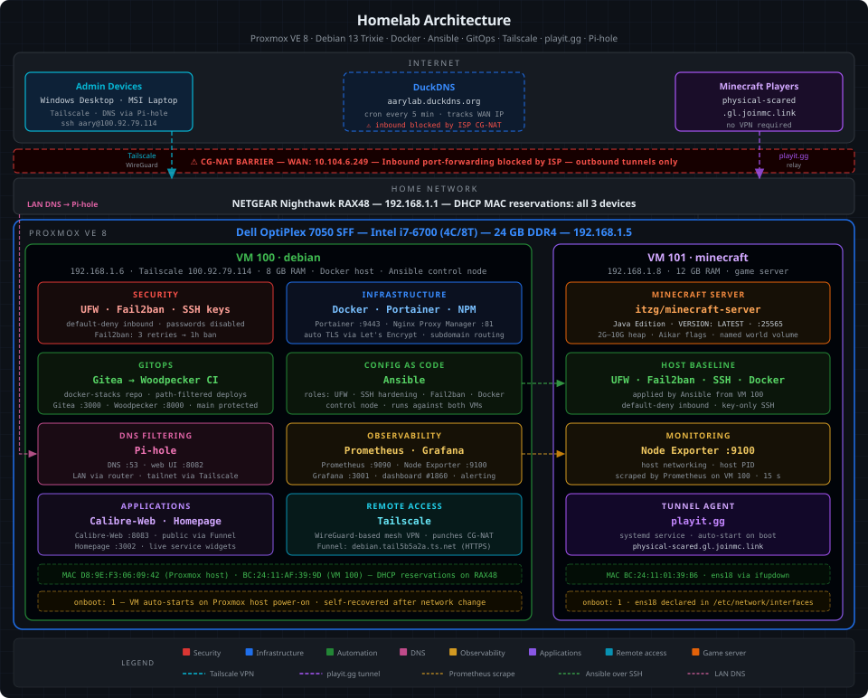
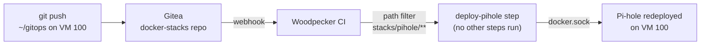

# Homelab
> Self-hosted DevOps stack on Proxmox VE · Debian 13 Trixie · Docker · Ansible · GitOps

A Proxmox VE 8 server on a Dell OptiPlex 7050 SFF, running two Debian 13 VMs and a Docker stack: Gitea with Woodpecker CI pipelines, Prometheus + Grafana monitoring, Nginx Proxy Manager with automatic TLS, and Pi-hole for network-wide DNS filtering. Both VMs are hardened with UFW, Fail2ban, and key-only SSH, codified as Ansible roles, and every Compose stack on the Docker host deploys from Git on push. The apartment ISP's CG-NAT rules out port forwarding, so remote admin runs over a Tailscale (WireGuard) mesh.

## Architecture



## Monitoring

Prometheus scrapes Node Exporter on both VMs every 15 s (labeled `debian-vm100` and `minecraft-vm101`), and Grafana visualizes them with the Node Exporter Full dashboard (ID 1860).

Grafana dashboard JSON model: [`node-exporter-full.json`](./docs/node-exporter-full.json)

## Hardware

| Component  | Details                                                     |
| ---------- | ----------------------------------------------------------- |
| Host       | Dell OptiPlex 7050 SFF                                      |
| CPU        | Intel Core i7-6700 (4C/8T, 3.4 GHz)                         |
| RAM        | 24 GB DDR4                                                  |
| Hypervisor | Proxmox VE 8                                                |
| Network    | NETGEAR RAX48 — DHCP MAC reservations for all three devices |

## Virtual machines

| VM                   | IP            | OS               | RAM   | Role                                             |
| -------------------- | ------------- | ---------------- | ----- | ------------------------------------------------ |
| VM 100 · `debian`    | `192.168.1.6` | Debian 13 Trixie | 8 GB  | Docker host, Ansible control node, GitOps target |
| VM 101 · `minecraft` | `192.168.1.8` | Debian 13 Trixie | 12 GB | Dedicated game server                            |

Both VMs are set to `onboot: 1` — they auto-start whenever the Proxmox host boots.

## Stack

| Layer             | Tool                                     | Purpose                                                                          |
| ----------------- | ---------------------------------------- | -------------------------------------------------------------------------------- |
| Hypervisor        | Proxmox VE 8                             | VM provisioning and management                                                   |
| Firewall          | UFW                                      | Default-deny inbound, explicit port allowlist                                    |
| IDS               | Fail2ban                                 | Auto-bans IPs after repeated failed logins                                       |
| Config management | Ansible                                  | UFW, SSH hardening, Fail2ban, and Docker Engine as roles, applied to both VMs    |
| VPN               | Tailscale                                | Mesh VPN for remote admin — punches through CG-NAT                               |
| DNS filtering     | Pi-hole                                  | Network-wide ad blocking for the LAN and the tailnet                             |
| Dynamic DNS       | DuckDNS (`aarylab.duckdns.org`)          | Dynamic hostname updated every 5 min via cron                                    |
| Proxy             | Nginx Proxy Manager                      | Reverse proxy + automatic TLS (Let's Encrypt)                                    |
| Management        | Portainer                                | Container UI and Docker Compose stack management                                 |
| Start page        | Homepage                                 | Service dashboard with live widgets for Portainer, Gitea, Grafana, and Minecraft |
| Git               | Gitea                                    | Self-hosted version control; hosts the GitOps repo                               |
| CI/CD             | Woodpecker 3                             | Path-filtered pipelines: a push redeploys only the stacks it changed             |
| Metrics           | Prometheus + Node Exporter               | Scrapes both VMs every 15 s                                                      |
| Dashboards        | Grafana                                  | Visualization, custom dashboards, threshold alerting                             |
| Media             | Calibre-Web                              | Self-hosted ebook library                                                        |
| Game              | Minecraft Java (`itzg/minecraft-server`) | Dedicated server with Aikar JVM flags                                            |
| Tunnel            | playit.gg                                | External Minecraft access despite CG-NAT                                         |

## Networking

The apartment ISP uses **CG-NAT** — the WAN IP is in the `10.x.x.x` range, making traditional inbound port forwarding from the router impossible.

Three-part solution:

- **Tailscale** (WireGuard-based mesh VPN): installed on VM 100 and all admin devices. Establishes peer-to-peer tunnels that punch through CG-NAT with no open ports required. VM 100 Tailscale IP: `100.92.79.114`. This handles all remote administration, and **Tailscale Funnel** publishes one service, Calibre-Web, at `https://debian.tail5b5a2a.ts.net` over an outbound-only tunnel.
- **playit.gg**: a tunnel agent on VM 101 proxies Minecraft traffic through playit's relay servers. Public join address: `physical-scared.gl.joinmc.link`. Friends connect here — no VPN, no port forwarding required.
- **DuckDNS** (`aarylab.duckdns.org`): tracks the dynamic public IP. Not used for direct inbound access (blocked by CG-NAT), but kept for reference and maintained via a 5-minute cron job.

### DNS filtering

**Pi-hole** runs as a container on VM 100 (web UI on port 8082) and answers DNS both at home and over the tailnet:

- **At home:** the RAX48's DNS points at VM 100 (`192.168.1.6`), so every device on the LAN is filtered with no per-device setup.
- **Away from home:** VM 100's Tailscale IP is the tailnet's global nameserver in the Tailscale admin console, with *Override DNS* on, so any device on the tailnet gets the same filtering on any network.
- **On VM 100 itself:** `tailscale set --accept-dns=false`, so the host's own lookups don't depend on the container it's hosting.

## Automation

### Configuration as code: Ansible

The Phase 1 hardening started as commands typed by hand. It now lives in Ansible roles for UFW, SSH hardening, Fail2ban, and Docker Engine, run from VM 100 (the control node) against both VMs. The playbook was validated with `--check` dry runs and live runs on both VMs, so a rebuilt VM gets the same baseline as the one it replaces.

### GitOps: push to deploy

Every Docker Compose stack on VM 100 lives in one Gitea repo, `docker-stacks`, as `stacks/<name>/docker-compose.yml`. A push sends a webhook to Woodpecker, and each stack has its own path-filtered deploy step, so a commit that only touches `stacks/pihole/` runs `deploy-pihole` and nothing else.



Stacks under GitOps: Calibre-Web, Gitea, Homepage, monitoring (Prometheus, Grafana, Node Exporter), Nginx Proxy Manager, Pi-hole, and Woodpecker itself.

Woodpecker 3 has two requirements here: each step's `when` block needs both an `event` and a `path` filter, and the repo must be marked Trusted with volumes allowed so steps can mount `docker.sock`. That mount is effectively root on VM 100, so anything that lands on `main` runs with full control of the host.

Guardrails, each added after something broke (details in [What I learned](#what-i-learned)):

- **Branch protection on `main`:** force pushes disabled, verified by attempting one.
- **Identical mount paths:** each step mounts its host stack directory at the same path inside the step container (`/home/aary/docker/<stack>`), so relative volume paths in the Compose file resolve to the real data on the host.
- **Explicit webhook allow-list:** Gitea's `[webhook] ALLOWED_HOST_LIST` names Woodpecker's Tailscale address, which restored push-to-deploy after a Gitea upgrade started blocking it.

## Services

| Service             | Internal port            | External access                              |
| ------------------- | ------------------------ | -------------------------------------------- |
| Portainer           | 9443                     | Tailscale only                               |
| Nginx Proxy Manager | 80 / 443 / 81            | Tailscale only                               |
| Homepage            | 3002                     | Tailscale only                               |
| Gitea               | 3000                     | Tailscale only                               |
| Woodpecker CI       | 8000                     | Tailscale only                               |
| Prometheus          | 9090                     | Tailscale only                               |
| Grafana             | 3001                     | Tailscale only                               |
| Node Exporter       | 9100 (both VMs)          | Internal only                                |
| Pi-hole             | 53 (DNS) / 8082 (web UI) | DNS for LAN + tailnet; web UI Tailscale only |
| Calibre-Web         | 8083                     | Tailscale Funnel (public HTTPS)              |
| Minecraft           | 25565                    | playit.gg → `physical-scared.gl.joinmc.link` |

## Build phases

- [x] **Phase 1 — Security foundation:** UFW default-deny, Fail2ban, SSH key auth (passwords disabled), DuckDNS cron, Tailscale
- [x] **Phase 2 — Container infrastructure:** Docker Engine, Portainer, Nginx Proxy Manager
- [x] **Phase 3 — Dev platform:** Gitea, Woodpecker CI/CD
- [x] **Phase 4 — Observability:** Node Exporter on both VMs, Prometheus, Grafana (dashboard #1860)
- [x] **Phase 5 — Documentation:** Architecture diagram, README, portfolio site, LinkedIn posts, resume bullets
- [x] **Phase 6 — Configuration as code:** Ansible roles for UFW, SSH hardening, Fail2ban, and Docker Engine across both VMs
- [x] **Phase 7 — GitOps:** `docker-stacks` repo in Gitea, path-filtered Woodpecker deploys, branch protection on `main`
- [ ] **Phase 8 — Provisioning as code:** OpenTofu to define the Proxmox VMs themselves

Added along the way: Calibre-Web with Tailscale Funnel, a dedicated Minecraft VM behind playit.gg, the Homepage start page, and Pi-hole.

## Why I built this

As a Computer Engineering student I wanted hands-on experience with the infrastructure layer that sits beneath every application I write in class. Cloud platforms handle it all behind a dashboard, but I wanted to understand what that dashboard is actually doing.

The original idea was simple: run a VPN, containerize some services, and complete the project. What I got instead was a semester-long lesson in every assumption I didn't know I was making. The first big surprise came when I discovered my apartment ISP uses **Carrier-Grade NAT** — my router's WAN IP (`10.104.6.249`) is itself behind a NAT I don't control. Port forwarding, the standard approach for remote homelab access, is simply impossible here. That constraint forced me to actually understand the problem rather than copy a tutorial: WireGuard needs reachable endpoints; CG-NAT removes them. The solution, Tailscale's coordination server bootstrapping peer-to-peer WireGuard tunnels, and playit.gg relaying Minecraft traffic, only made sense once I understood *why* the naive approach failed.

I also wanted something concrete to talk about in internship interviews. A deployed stack that I've broken and recovered, that runs continuously, that I monitor and maintain, that's a different kind of evidence than coursework.

## What I learned

**Networking from first principles.** I came in knowing what a VPN is; I left knowing how WireGuard key exchange works, why STUN/ICE punching succeeds against residential NAT but fails against CG-NAT, and what a CGNAT address block looks like (`100.64.0.0/10` for Tailscale's coordination network, `10.x.x.x` for my ISP). DNS went from "the thing that turns names into IPs" to a moving target I have to chase every time my ISP rotates my IP — hence DuckDNS on a cron job.

**Linux as a system, not just a shell.** Debugging a VM that lost network access after an apartment router change meant reading `/etc/network/interfaces`, understanding that Debian 13 minimal installs use `ifupdown` with no NetworkManager or `dhclient`, and manually adding an `ens18` stanza to bring the interface up. No GUI, no safety net — just a Proxmox console and some simple documentation.

**Containers in practice.** Running Docker in production (even home-lab production) surfaces things tutorials skip: named volumes versus bind mounts and why it matters for backups, the difference between `unless-stopped` and `always` restart policies, how `docker.sock` mounts give Portainer the access it needs, and why `network_mode: host` is sometimes the right call for a monitoring exporter.

**Observability as a discipline.** Prometheus scraping Node Exporter on two VMs every 15 seconds, labels to distinguish hosts, PromQL to write meaningful queries, Grafana dashboard #1860 as a starting point rather than the endpoint — this stack is the same one used at Uber, GitLab, and DigitalOcean. Running it yourself makes it non-intimidating.

**Resilience through failure.** The most educational moment wasn't any successful deployment — it was the network change that left VM 101 unreachable and VM 100 reachable only via Tailscale. Recovering without physical access to one VM, reasoning about what changed (DHCP lease order, router SSID change) versus what didn't (Tailscale peer state on VM 100), and deciding what to fix permanently (DHCP MAC reservations, `onboot: 1`, documented `/etc/network/interfaces` configs) built more operational instinct than any lab exercise.

**Infrastructure code needs testing like any other code.** The Ansible scaffold looked right and wasn't. A global `become` in `ansible.cfg` broke ad-hoc commands, `group_vars/` sat one directory too high for Ansible to discover it, a task missing `check_mode: false` broke every dry run, and an SSH-hardening regex matched comment prose instead of the real directives. None of that was visible from reading the playbook; all of it surfaced as soon as something actually ran. The most dangerous bug was the quiet one: a missing UFW rule for Node Exporter on VM 101 would have passed the playbook run and silently dropped that VM out of Grafana.

**GitOps needs guardrails, not just a pipeline.** Adding Pi-hole to the pipeline surfaced several problems at once. An empty test commit fired every deploy step together, and because the steps mounted each stack at `/deploy/<name>` rather than its real host path, Compose resolved relative volume paths to directories that didn't exist on the host. Docker created them empty, and five containers came back up pointed at blank data. The real data was untouched in `~/docker/<stack>/`, so recovery meant recreating those containers from the right paths. Along the way I found that a stray second clone had force-pushed an unrelated snapshot over `main`, and that a Gitea upgrade had started refusing webhook deliveries to Woodpecker's Tailscale address, so pushes had quietly stopped deploying. Each fix is now permanent: identical mount paths on both sides, branch protection with force pushes disabled (tested by attempting one), and an explicit webhook allow-list.

## Reproducing this setup

### Prerequisites

- A machine capable of running Proxmox VE (or any Debian 13 VM as a starting point)
- A router with DHCP reservation support
- Free accounts: [DuckDNS](https://www.duckdns.org), [Tailscale](https://tailscale.com), [playit.gg](https://playit.gg) *(game server only)*

### Setup order

```bash
# 1. Install Proxmox VE, create two Debian 13 VMs
#    Set onboot: 1 on both in Proxmox Options
#    Add DHCP MAC reservations in your router for all three devices

# 2. Phase 1 — security (run on VM 100)
sudo apt install ufw fail2ban -y
sudo ufw default deny incoming && sudo ufw allow 22/tcp && sudo ufw enable
# Configure SSH key auth, disable password login in /etc/ssh/sshd_config
# DuckDNS cron: */5 * * * * ~/duckdns/duck.sh >/dev/null 2>&1
curl -fsSL https://tailscale.com/install.sh | sh && sudo tailscale up

# 3. Phase 2 — containers
curl -fsSL https://get.docker.com | sudo sh
sudo usermod -aG docker $USER
# Deploy Portainer and Nginx Proxy Manager via Docker Compose

# 4. Phase 3 — dev platform
# Deploy Gitea, then Woodpecker; connect via webhook in Gitea settings

# 5. Phase 4 — observability
# Deploy Node Exporter (on both VMs), Prometheus, Grafana
# In Grafana: Connections → Prometheus → http://prometheus:9090
# Import dashboard ID 1860 (Node Exporter Full)

# 6. VM 101 — game server
# Install Docker, run itzg/minecraft-server, install playit.gg agent as systemd service

# 7. Ansible — codify steps 2-3 as roles (UFW, SSH hardening, Fail2ban, Docker Engine)
#    Control node: VM 100; inventory covers both VMs; group_vars/ goes inside inventory/
#    Dry-run every change first: ansible-playbook ... --check

# 8. GitOps — move each stack into a Gitea repo as stacks/<name>/docker-compose.yml
#    .woodpecker.yml: one deploy step per stack, each `when` with both event and path
#    Mark the repo Trusted (volumes allowed) so steps can mount /var/run/docker.sock
#    Mount each host stack directory at the SAME path inside its step

# 9. Pi-hole — deploy it as a stack, then point the router's DNS at VM 100
#    Tailscale admin console → DNS: VM 100's Tailscale IP as global nameserver, Override DNS on
#    Then, on VM 100 only:
sudo tailscale set --accept-dns=false
```

**Critical:** add DHCP MAC reservations in your router for all three devices (Proxmox host + both VMs). IP drift after reboots or network changes will break connectivity.

**If your ISP uses CG-NAT:** skip WireGuard self-hosting. Use Tailscale for admin access (it handles the NAT punch) and playit.gg for any service that needs a public inbound address without a VPN.

**Gotchas worth knowing:**

- Debian 13 minimal installs use `ifupdown`, not NetworkManager. After a router change, check that `ens18` is declared in `/etc/network/interfaces` (`auto ens18` + `iface ens18 inet dhcp`), then bring it up with `sudo ifup ens18`.
- If Gitea stops delivering webhooks to a private or Tailscale address after an upgrade, add that address to `[webhook] ALLOWED_HOST_LIST` in `app.ini`.
- Homepage's Grafana widget needs a Grafana username and password; service-account tokens don't work.
- Read the prompt before every command: `root@pve` is the Proxmox host, `aary@debian` is VM 100.
